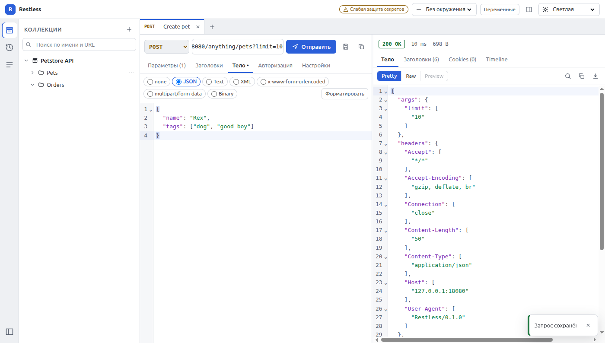
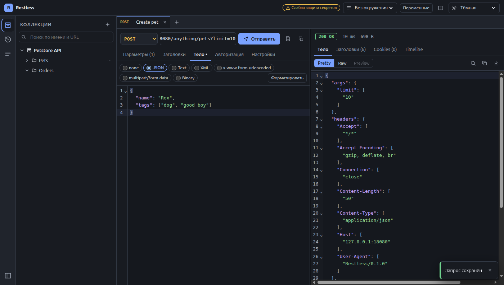
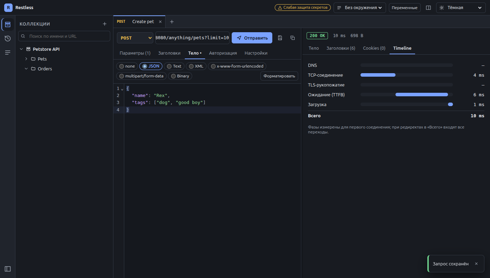

# Restless

Локальный офлайн REST-клиент на Electron в духе Postman/Insomnia — без регистрации и облака.



| Тёмная тема                                    | Timeline                                        |
| ---------------------------------------------- | ----------------------------------------------- |
|  |  |

## Возможности (MVP)

- **Запрос:** GET/POST/PUT/PATCH/DELETE/HEAD/OPTIONS и произвольный метод; URL с подсветкой `{{переменных}}` и
  двусторонней синхронизацией с таблицей Query Params; заголовки; тела none, JSON (валидация, форматирование),
  text, XML, x-www-form-urlencoded, multipart/form-data с файлами, binary; авто `Content-Type`; таймаут,
  редиректы, проверка SSL.
- **Ответ:** статус с цветом по классу, время, размер; Body (Pretty / Raw / Preview для HTML и картинок),
  Headers, Cookies, Timeline (DNS, TCP, TLS, TTFB, загрузка); поиск, сворачивание JSON, копирование,
  сохранение в файл; ответы больше 5 МБ — в Raw без подсветки. Отправка — `Ctrl+Enter`, есть отмена.
- **Вкладки** с индикатором несохранённых изменений; восстанавливаются после перезапуска, черновики
  автосохраняются каждые 5 с.
- **Коллекции** с вложенными папками, drag-and-drop, дублирование, поиск по имени и URL, переменные коллекции.
- **Окружения и переменные:** глобальные → коллекция → окружение (приоритет: окружение → коллекция → глобальные),
  подсказка значения при наведении, автодополнение после `{{`, предупреждение о неразрешённых; секретные
  переменные шифруются через `safeStorage` и не попадают в renderer, историю и логи.
- **История:** каждый запрос с кратким ответом (статус, время, первые 100 КБ тела), группировка по дням,
  повтор в один клик, сохранение в коллекцию, лимит 1000 записей с ротацией.
- **cURL:** вставка команды в поле URL превращает её в запрос; «Копировать как cURL» (для секретов — подтверждение).
- Темы светлая/тёмная/системная, интерфейс на русском и английском, нативное меню, полная работа с клавиатуры.

Вторая очередь (авторизация, импорт Postman/OpenAPI, генерация кода, скрипты, раннер, cookie jar, прокси,
GraphQL, WebSocket/SSE, хранение в файлах) — после v1.0.0, см. ТЗ раздел 5.

## Быстрый старт

Нужны Docker с Compose v2.20+, Node.js 22 LTS и GNU Make (на Windows — в WSL2).

```bash
git clone https://github.com/restless-app/restless.git && cd restless && make up
```

`make up` создаёт `.env` из `.env.example`, ставит зависимости, поднимает PostgreSQL 16, go-httpbin и
ежедневные бэкапы в Docker, применяет миграции и запускает приложение в dev-режиме. Окно Electron работает
на хосте; Docker отвечает только за инфраструктуру.

Если порт из `.env` занят (например, `8080` для echo-api), поменяйте `ECHO_PORT` / `POSTGRES_PORT` в `.env`.

Пароль БД в `.env` указан дважды: в `POSTGRES_PASSWORD` (для контейнеров) и в `DATABASE_URL` (для приложения),
и значения должны совпадать — `make` проверяет это перед запуском. PostgreSQL берёт `POSTGRES_PASSWORD` только при
первом создании тома, поэтому, чтобы сменить пароль позже, поменяйте его и в БД
(`make psql`, затем `ALTER USER restless PASSWORD '…';`) или пересоздайте том с потерей данных: `make reset`.

### Команды

| Команда                               | Что делает                                                            |
| ------------------------------------- | --------------------------------------------------------------------- |
| `make up`                             | Развернуть всё и запустить приложение                                 |
| `make db` / `make migrate`            | Поднять БД, тестовый API и бэкапы / применить миграции                |
| `make dev`                            | Запустить Electron в dev-режиме (HMR)                                 |
| `make down` / `make reset`            | Остановить контейнеры (данные сохраняются) / удалить БД и пересоздать |
| `make test`                           | Unit-тесты (Vitest, слой хранилища — на PGlite)                       |
| `make test-int`                       | Интеграционные тесты против PostgreSQL и echo-api                     |
| `make e2e`                            | E2E-сценарии 1–5 (Playwright for Electron)                            |
| `make lint`                           | ESLint, Prettier и проверка типов                                     |
| `make dist` / `make dist-docker`      | Инсталлятор для текущей ОС / Linux и Windows в контейнере             |
| `make backup` / `make restore FILE=…` | Дамп БД в `backups/` (хранятся 7) / восстановление                    |
| `make psql` / `make logs`             | Консоль psql / логи PostgreSQL                                        |

Ежедневные дампы делает сервис `backup` из `docker-compose.yml` (`BACKUP_INTERVAL_SECONDS`, `BACKUP_KEEP` в `.env`).

## Горячие клавиши

На macOS вместо `Ctrl` — `Cmd`.

| Действие                       | Клавиши                       |
| ------------------------------ | ----------------------------- |
| Отправить запрос               | `Ctrl+Enter`                  |
| Новый запрос                   | `Ctrl+N`                      |
| Сохранить                      | `Ctrl+S`                      |
| Закрыть вкладку                | `Ctrl+W`                      |
| Следующая / предыдущая вкладка | `Ctrl+Tab` / `Ctrl+Shift+Tab` |
| Быстрый поиск запросов         | `Ctrl+P`                      |
| Форматировать тело             | `Ctrl+Shift+F`                |
| Сменить окружение              | `Ctrl+E`                      |
| Показать/скрыть боковую панель | `Ctrl+B`                      |

В дереве коллекций: стрелки, `Enter` — открыть, `F2` — переименовать, `Delete` — удалить,
`Shift+F10` — контекстное меню.

## Архитектура

```
src/
  main/       main-процесс: окно и безопасность, IPC-обработчики (zod), HTTP-клиент (undici),
              хранилище (pg + Drizzle), секреты (safeStorage), меню, автообновление
  preload/    contextBridge: узкий типизированный window.api, ipcRenderer наружу не отдаётся
  renderer/   React + Zustand + CodeMirror 6 — только интерфейс
  shared/     модель данных, контракт IPC (каналы + zod-схемы), переменные, cURL, i18n
drizzle/      SQL-миграции (drizzle-kit generate), применяются make migrate и самим приложением при старте
tests/        unit / integration / e2e
```

Renderer считается недоверенным: сеть, файлы и секреты — только в main. Подробнее о мерах безопасности:

- `contextIsolation`, `sandbox`, `webSecurity` включены, `nodeIntegration` выключен; строгий CSP без
  `unsafe-eval` и удалённых скриптов; навигация и новые окна запрещены, внешние `http(s)`-ссылки открываются
  в браузере.
- Каждый IPC-вызов проверяет отправителя (`event.senderFrame`) и валидирует вход по zod-схеме.
- Файлы для multipart/binary main читает только если пользователь выбрал их в системном диалоге.
- HTML-ответ в Preview рендерится в `<iframe sandbox>` без скриптов.
- Секреты хранятся как `enc:v1:<base64>` (`safeStorage`). Подстановка переменных выполняется в main;
  в историю пишется исходный запрос с `{{token}}`, а значения секретов в ответах маскируются.
- Строка подключения к БД, введённая на экране подключения, хранится зашифрованной и в renderer не возвращается.
- Electron Fuses: отключены `RunAsNode`, `EnableNodeCliInspectArguments`, `NODE_OPTIONS`; включены проверка
  целостности ASAR и загрузка только из ASAR.

> **Linux без keyring.** Если нет gnome-keyring / KWallet, Electron использует backend `basic_text`
> (фиксированный ключ). Секреты всё равно не лежат в БД открытым текстом, но защита слабее — в шапке
> приложения появляется предупреждение «Слабая защита секретов».

### Модель данных

PostgreSQL 16: `workspaces`, `collections`, `folders`, `requests`, `environments`, `variables`, `history`,
`open_tabs` — uuid-ключи, `jsonb`, `timestamptz`, enum `variable_scope`, каскадные внешние ключи, GIN-индексы
`pg_trgm` по `requests.name` и `requests.url`. У `variables.scope_id` нет внешнего ключа (он указывает на
окружение, коллекцию или рабочее пространство), поэтому каскадное удаление переменных делают триггеры.

Если БД недоступна, приложение не падает, а показывает экран подключения с полем строки подключения.

## Сборка из исходников

```bash
npm ci
npm run build        # main, preload, renderer → out/
npm run dist         # инсталлятор для текущей ОС → dist/
```

Цели: Windows NSIS (x64), macOS DMG (x64 и arm64), Linux AppImage и deb (x64). Инсталлятор для macOS
собирается только на macOS (подпись и нотаризация).

**Подпись кода.** На первом этапе сборки **не подписаны**: Windows SmartScreen и macOS Gatekeeper
покажут предупреждение. Чтобы подписывать, задайте в секретах репозитория `CSC_LINK`, `CSC_KEY_PASSWORD`,
а для macOS — `APPLE_ID`, `APPLE_APP_SPECIFIC_PASSWORD`, `APPLE_TEAM_ID`.

## Релизы и CI

- На каждый PR: ESLint, Prettier, `tsc --noEmit`, unit-тесты с покрытием, `make test-int`, `npm audit`.
- На тег `v*`: e2e-тесты, сборка на Windows / macOS / Linux и публикация в GitHub Releases.
- Автообновление — electron-updater из GitHub Releases; канал stable или beta (теги `vX.Y.Z-beta.N`).

## Лицензия

[MIT](LICENSE)
